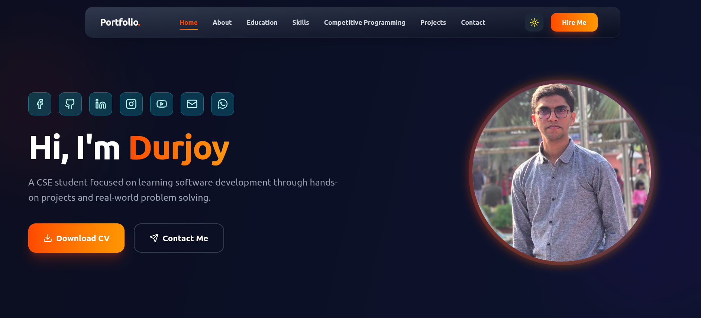
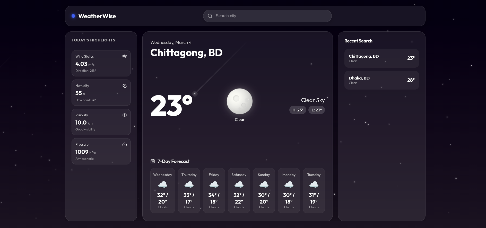
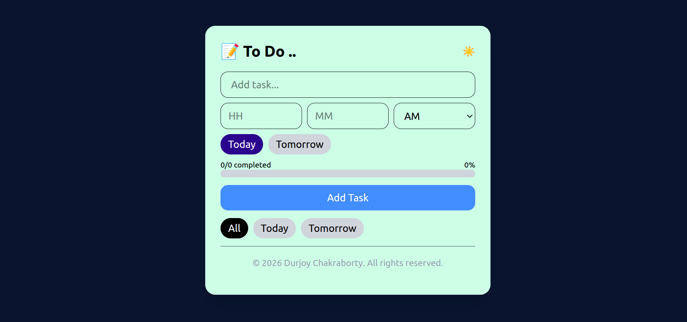
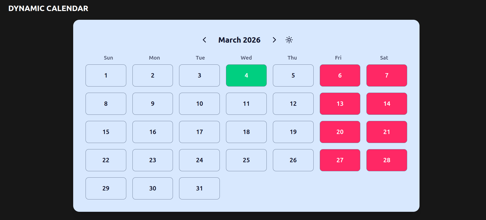
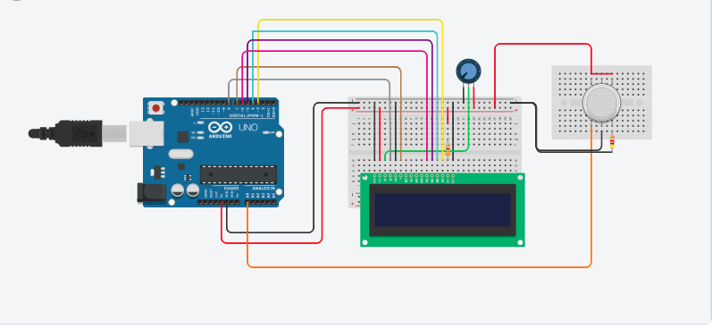
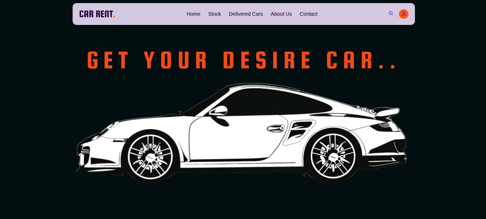

 

# 👋 Hey, I'm Durjoy Chakraborty

### `Frontend Developer` · `CSE Student` · `Tech Enthusiast`

  

 

  

---

## 👨‍💻 About Me

Hi! I'm **Durjoy Chakraborty**, a CSE Student and passionate **Frontend Developer** who enjoys turning ideas into modern, responsive, and interactive web applications.

- 🌐 Skilled in **React, Tailwind CSS, and JavaScript**
- ⚡ Focused on **clean UI, smooth UX, and responsive designs**
- 🚀 Currently exploring **Node.js, TypeScript, and Machine Learning**
- 🧠 Always learning and improving through **projects and new technologies**

🎯 My goal is to build **beautiful, performant, and user-friendly web applications.**

---

## 🚀 Featured Projects

<table>
<tr>
<td width="50%" valign="top">

### 🌦️ Weather Forecast App

Real-time weather search with a responsive interface.

 

</td>
<td width="50%" valign="top">

### ✅ Modern To-Do List

Task management with dark mode and localStorage.

 

</td>
</tr>

<tr>
<td width="50%" valign="top">

### 📅 Dynamic Calendar

Interactive calendar with dynamic navigation.

 

</td>
<td width="50%" valign="top">

### ⚡ Arduino Projects

Sensor-based systems with LCD display.

 

</td>
</tr>

<tr>
<td width="50%" valign="top">

### 🚗 Car Rental Website

Responsive car rental and booking interface.

 

</td>
<td width="50%" valign="top">

### ✨ Next Project

Something exciting coming soon...

</td>
</tr>
</table>

---

## 🛠️ Skills & Tools

### Frontend Development

### Backend & Programming

### Tools & Technologies

---

### Made with ❤️ in Chattogram, Bangladesh

